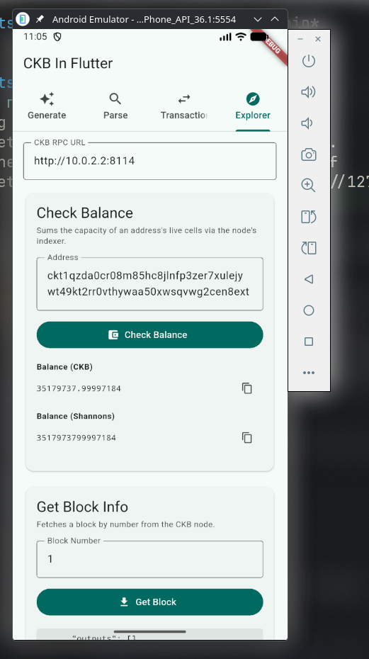
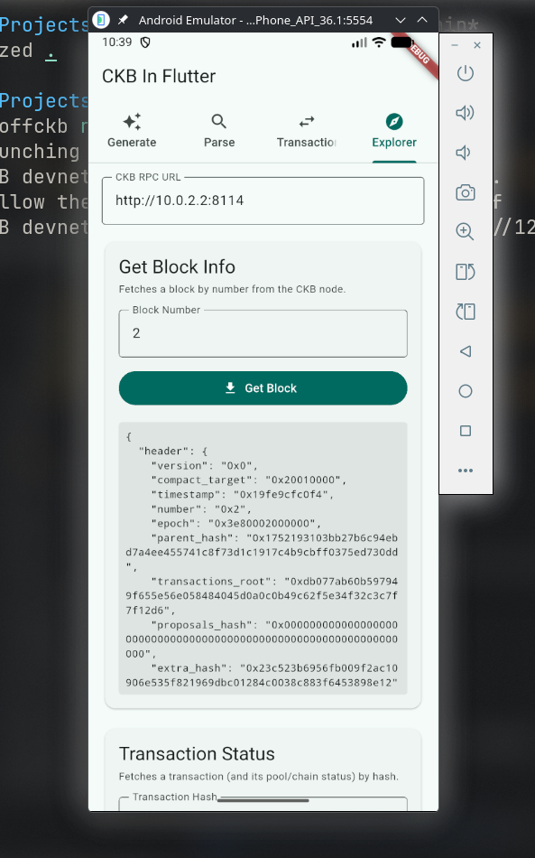
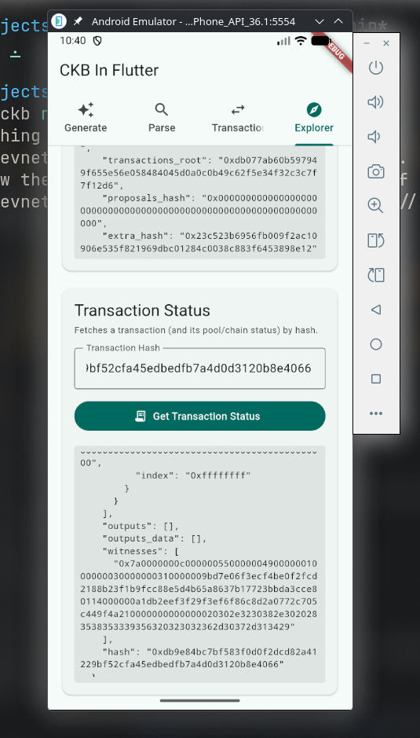

# Week 5 Report — CKBuilder Track

**Period:** September 14 – September 20, 2026

**Participant:** Abdulrasheed Fawole (bolaji1729)

**Track:** Builder

---

## Summary

The highlight of this week is the continued integration of the Rust SDK with Flutter. A simple explorer with balance check, node info, and transaction status was added to the demo Flutter app, and all three features were validated end-to-end against a local devnet.

---

## Completed This Week

- Implemented `send_transaction` (broadcast) to complete the build → sign → broadcast → confirm transfer flow.
- Implemented `get_block_info` and `get_transaction_status` RPC wrappers, exposed via `flutter_rust_bridge`.
- Implemented a "Check Balance" feature using the CKB indexer's `get_cells_capacity` RPC and `CellQueryOptions`.
- Set up a local devnet with the `offckb` CLI and validated all new RPC features against it end-to-end, including a real broadcast transaction that reached `committed` status on-chain.
- Explored the CKB RPC protocol and its various types and API operations.
- Revisited the materials on script fundamentals to strengthen my understanding of CKB theory.

#### Explorer Check Balance

#### Explorer Node Info

#### Explorer Transaction Status

All screenshots above are from the app running on an Android Emulator.

**Links:**

- [Rust SDK getting started](https://docs.nervos.org/docs/sdk-and-devtool/rust)

- [CargoKit Github](https://github.com/irondash/cargokit)

- [Android Emulator Network Address Space](https://developer.android.com/studio/run/emulator-networking-address)

- [Flutter Rust Bridge](https://github.com/fzyzcjy/flutter_rust_bridge)

- [CKB flutter app](https://github.com/Abdulrasheed1729/ckb_flutter_app)

- [CKB RPC Protocol](https://github.com/nervosnetwork/ckb/blob/master/rpc/README.md)

- [Getting started with CKB RPC](https://docs.nervos.org/docs/getting-started/rpcs)

- [CKB Explorer](https://explorer.nervos.org/)

- [offckb CLI](https://github.com/nervosnetwork/offckb)

---

## Blockers

- None this week. Minor friction points along the way: `flutter_rust_bridge_codegen` needed extra write access to the Flutter SDK and cargo home directories on first run (to write engine cache files and install `cargo-expand`), and I had to catch/repair a botched in-place edit to `main.dart` mid-week via diagnostics — no lasting impact on progress.

---

## Plan for Week 6

- Implement a UDT transfer feature and/or a Nervos DAO deposit tab against the local devnet (both `sudt`/`xudt` and `dao` system scripts are already deployed there).
- Explore more options for writing an SDK for Dart -- native with Rust codegen (`flutter_rust_bridge`), FFI from C, or a pure Dart implementation.
- Further study of the CKB protocol.
