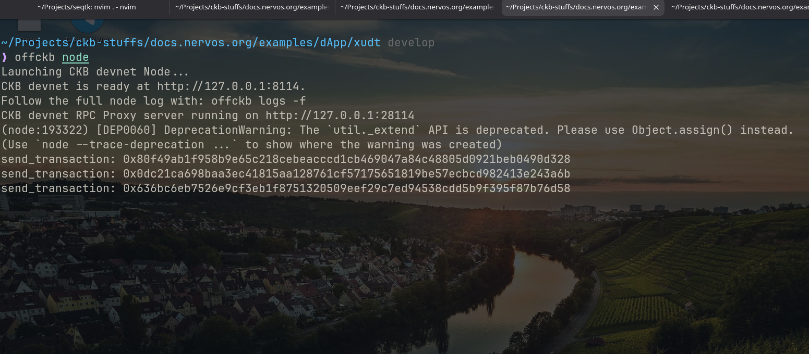
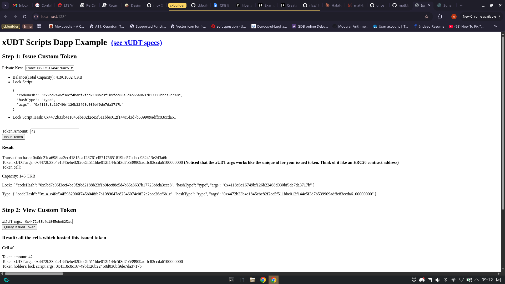
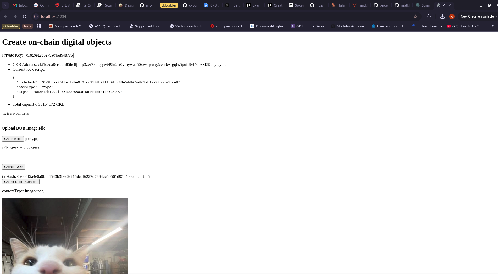
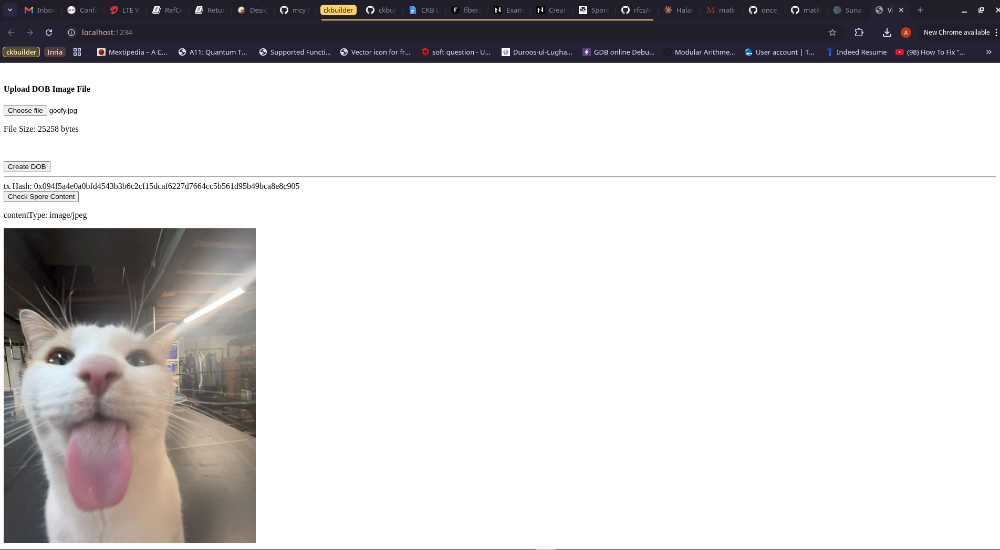

# Week 6 Report — CKBuilder Track

**Period:** September 21 – September 27, 2026

**Participant:** Abdulrasheed Fawole (bolaji1729)

**Track:** Builder

---

## Summary

This week focused on getting tokens and digital objects on-chain against a local devnet: I created a CKB transaction containing an xUDT cell, transferred that token to a second account, then used the spore SDK to create an on-chain image digital object and render it in the browser.

Alongside the on-chain work I finished the Rust book's functional-programming and smart-pointer chapters plus the rustlings exercises, comparing Rust's ownership model against C++.

---

## Completed This Week

- Continuation of the Rust Programming language learning.

    - Read through the chapters on functional programming and smart pointers in the Rust book.

    - Learnt the similar behaviours of the smart pointers in C++ and Rust and compared them.

    - Finished exercises on the JetBrains rustling course.

- Walked through the fungible token creation tutorial.

    - Created a CKB transaction containing a xUDT Cell in the outputs.

    - Transferred the created token to another account on the devnet.

    - Read the RFC on the specifications of s/xUDTs.

    - Read the RFC on the CKB transaction structure.

- Walked through the digital object creation tutorial.

    - Created an on-chain image digital object using the spore SDK.

    - Rendered the created digital object on the web.

### Screenshots

#### Offckb running

#### xUDT dApp

#### Spore DOB dApp -- Digital object creation form

#### Spore DOB dApp -- Rendered digital object

**Links:**

- [Token creation tutorial](https://docs.nervos.org/docs/dapp/create-token)

- [xUDT High level explanation](https://docs.nervos.org/docs/assets-token-standards/xudt)

- [xUDT RFC (0052)](https://github.com/nervosnetwork/rfcs/blob/master/rfcs/0052-extensible-udt/0052-extensible-udt.md)

- [Spore Digital Object Creation Tutorial](https://docs.nervos.org/docs/dapp/create-dob)

- [Spore Protocol Docs](https://docs.spore.pro/)

- [CKB transaction structure RFC (0022)](https://github.com/nervosnetwork/rfcs/blob/master/rfcs/0022-transaction-structure/0022-transaction-structure.md)
- [offckb CLI](https://github.com/nervosnetwork/offckb)

- [Rustlings](https://github.com/rust-lang/rustlings)

- [The Rust Book](https://doc.rust-lang.org/stable/book/)

---

## Blockers

- Unable to create a native Flutter implementation of the token creation.

- The spore DOB native implementation looks impossible, since the officially supported SDK for spore is in JS.

---

## Plan for Week 7

- Use the Rust SDK to write an implementation of the token creation for `flutter_rust_bridge` conversion for use in the demo Flutter app.

- Write a simple Rust xUDT script and deploy it on the devnet for testing.

