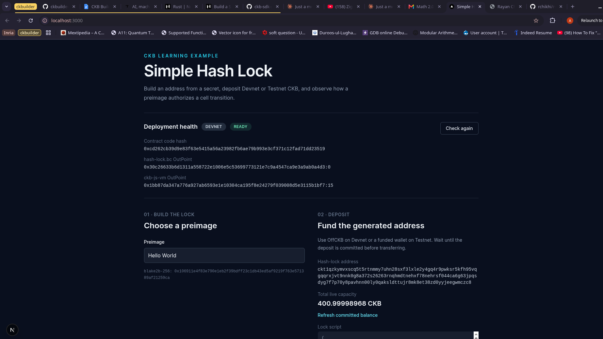
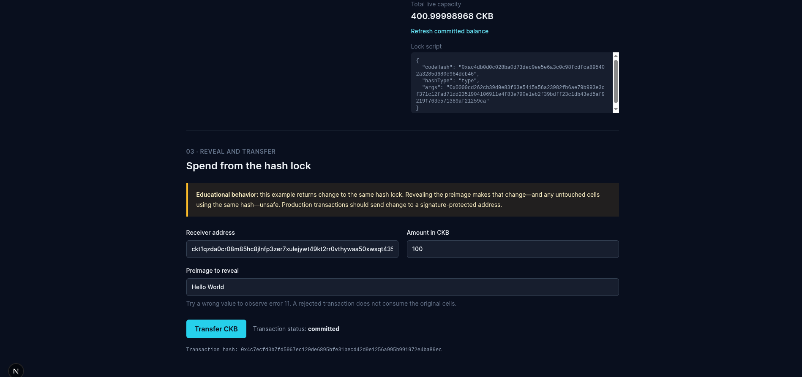
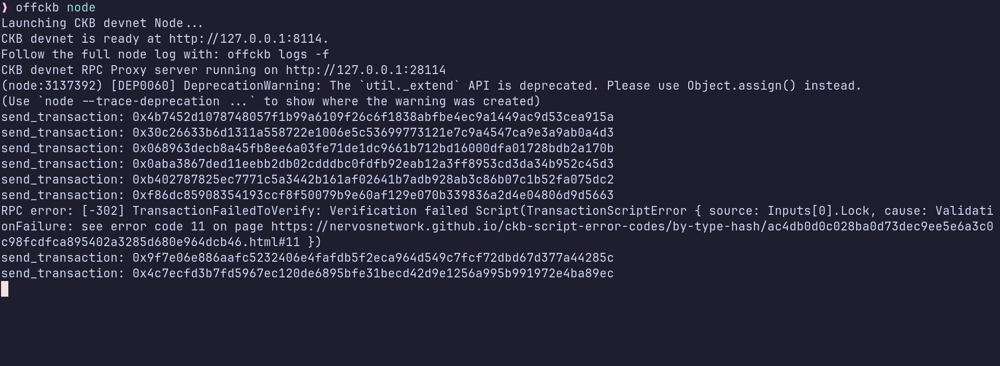

# Week 8 Report — CKBuilder Track

**Period:** October 05 – October 11, 2026

**Participant:** Abdulrasheed Fawole (bolaji1729)

**Track:** Builder

---

## Summary

This is week is focused on learning how to build a full-stack CKB dApp with a lock script that stores the hash of a secret in its arguments.
I also explored the nervos talk forum for ideas on what to build as my first project.

---

## Completed This Week

- Building a full-stack CKB dapp.

    - deployed a lock script written to run on the ckb-js-vm interpreter on devnet

    - funded the deployed hash lock with the offckb cli `deposit` utility

    - tested the deployed dapp with different preimage inputs

- Idea exploration
    -  Browsed through the Nervos Talk forum for ideas on project to build

### Pictures

- Deployed Frontend

- Offckb running

**Links:**

- [CKB transaction structure RFC (0022)](https://github.com/nervosnetwork/rfcs/blob/master/rfcs/0022-transaction-structure/0022-transaction-structure.md)

- [Simple Lock doc tutorial](https://docs.nervos.org/docs/script/rust/rust-example-simple-lock)

- [offckb CLI](https://github.com/nervosnetwork/offckb)

- [ckb sdk docs](https://docs.rs/ckb-sdk/5.1.0/ckb_sdk/)

- [CKB-js-vm](https://docs.nervos.org/docs/script/js/js-vm-build)

- [Nervos Talk Forum](https://talk.nervos.org/)

---

## Blockers

- Unable to deploy the lock script to the testnet due to some glitches.

---

## Plan for Week 8

- Start building my first project on the CKB.

