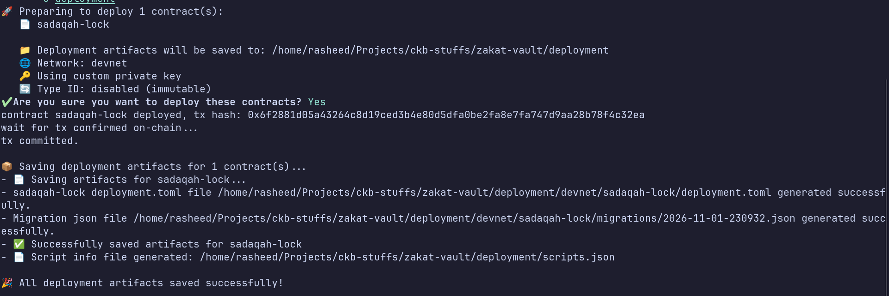
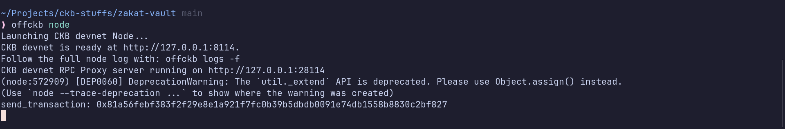
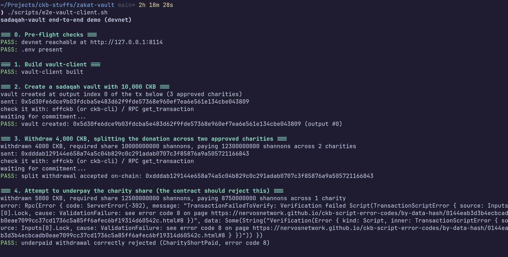
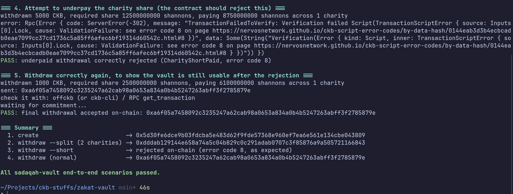
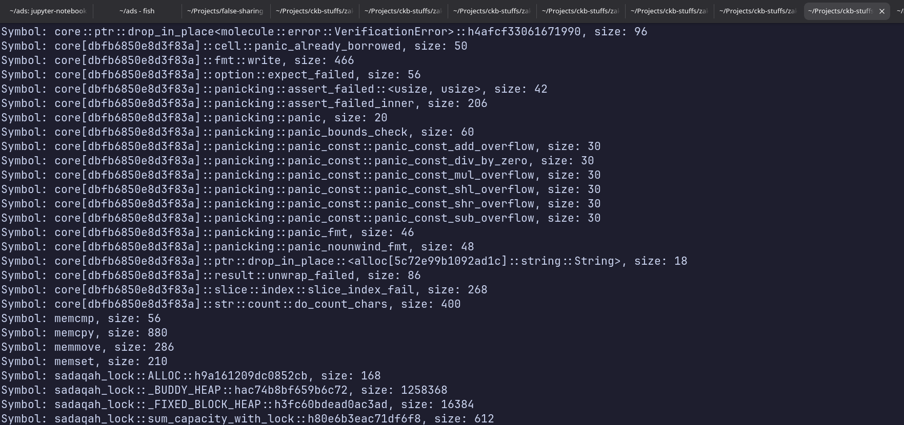

# Week 11 Report — CKBuilder Track

**Period:** October 26 – November 1, 2026

**Participant:** Abdulrasheed Fawole (bolaji1729)

**Track:** Builder

---

## Summary

The highlight of this week is getting the sadaqah-vault contract deployed and exercised end-to-end on a local devnet: built a Rust `vault-client` CLI to create and withdraw from vault cells, deployed the contract with `offckb`, and wrote a scripted end-to-end demo for reporting.

In addition, the `ckb-script-size-analyzer` community tool was also ran against the script for size investigation.

---

## Completed This Week

- Deployed the contract to a local devnet
    - Used `offckb` to run a devnet and deploy `sadaqah-lock`, tracked under `deployment/devnet/sadaqah-lock/` (`deployment.toml` + migration history).

- Built `vault-client`, a Rust CLI for interacting with the vault
    - `create <ckb>`: locks capacity into a new vault cell under the owner's approved args.

    - `withdraw <tx_hash> <index> <ckb>`: withdraws from the vault, computing and paying the required charity share, with owner authorization signed the way the default secp256k1-blake160 lock expects.

    - `withdraw ... --short`: deliberately underpays the charity share, to confirm the contract rejects it.

    - `withdraw ... --split a,b,...` to pay specific amounts to specific approved charities in one withdrawal, so the client actually exercises the multi-charity feature instead of only the single-charity path.

- Wrote a scripted end-to-end demo
    - `scripts/e2e-vault-client.sh` runs the full flow against the live devnet: pre-flight checks, create a vault, withdraw with a 2-charity split, attempt an underpaid withdrawal (asserting it's rejected with the exact `CharityShortPaid` error code), then withdraw correctly again to prove the vault is still usable.

    - Added `scripts/wait-for-tx.sh` to poll for transaction commitment between steps.

    - Ran it against the live devnet: all 5 steps passed, including the on-chain rejection of the underpaid withdrawal.

- Investigated script size using the `ckb-script-size-analyzer` too.

## Screenshots

- Deployment to devnet

- Offckb Running

- End-to-End Demo

- Size Analyser runnig

**Links:**

- [sadaqah-vault](https://github.com/Abdulrasheed1729/zakat-vault)

- [vault-client CLI](https://github.com/Abdulrasheed1729/zakat-vault/tree/main/vault-client)

- [offckb](https://github.com/nervosnetwork/offckb)

- [ckb-sdk (Rust) docs](https://docs.rs/ckb-sdk/5.1.0/ckb_sdk/)

- [CKB transaction structure RFC (0022)](https://github.com/nervosnetwork/rfcs/blob/master/rfcs/0022-transaction-structure/0022-transaction-structure.md)

---

## Blockers

- None blocking this week.

---

## Plan for Week 12

- Consider testnet deployment now that the devnet flow is solid end-to-end.

- Not decided yet, but I look forward to start exploring either of Spore or Fiber in-depth.

