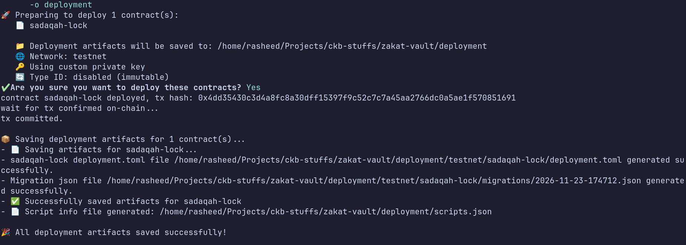
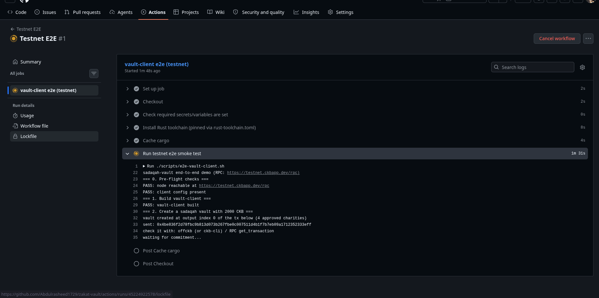
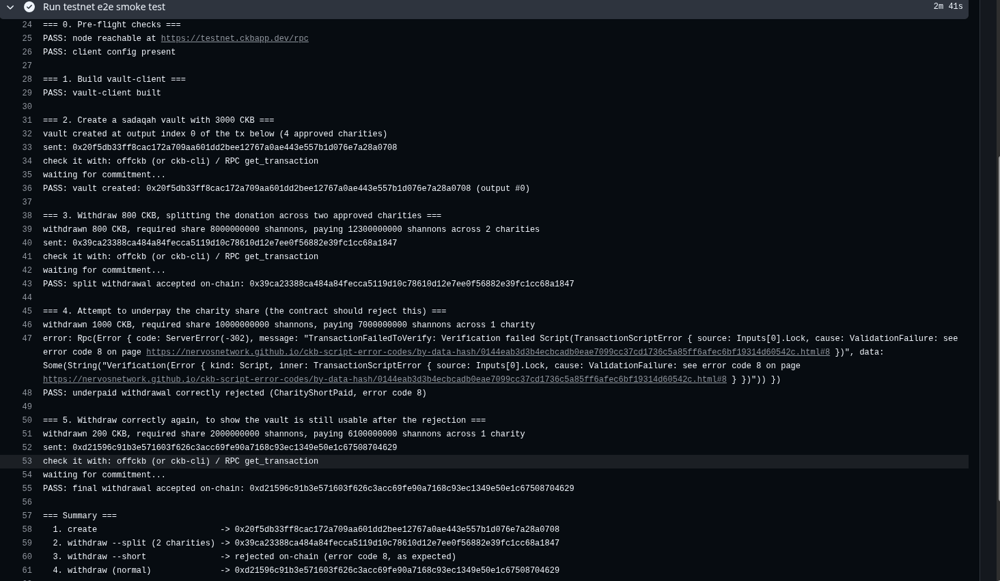
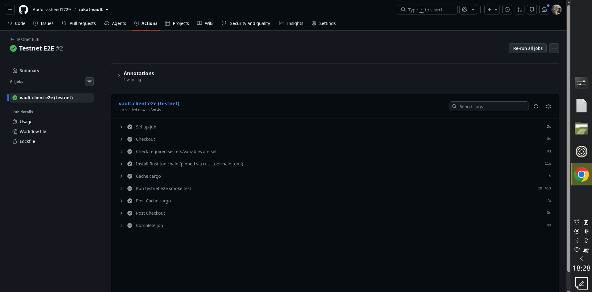
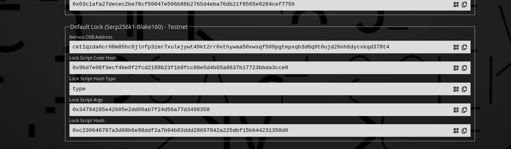
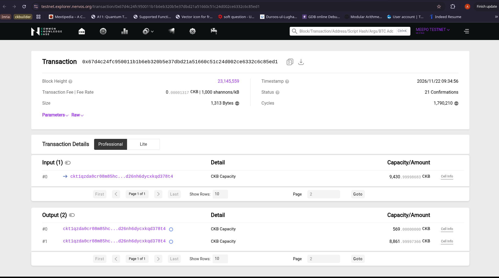
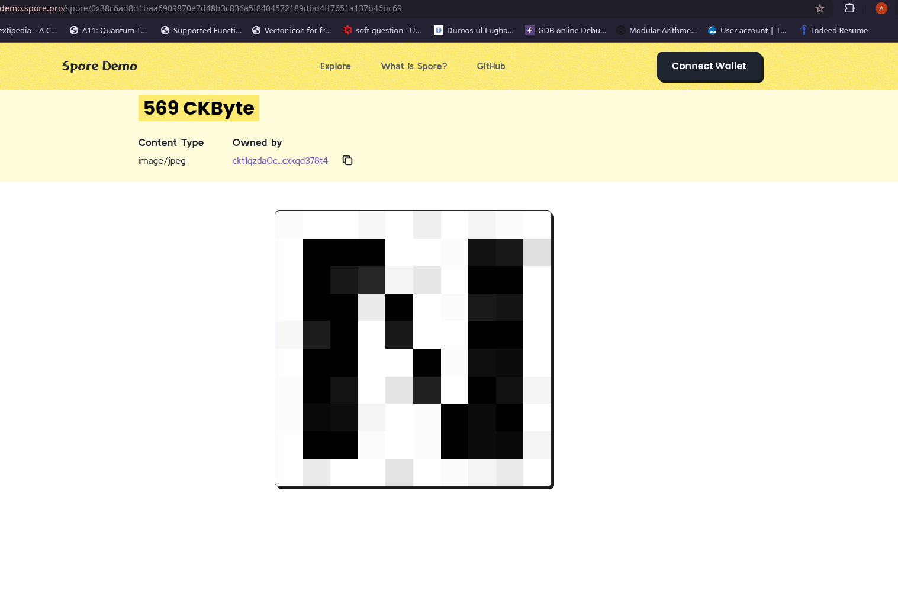

# Week 12 Report — CKBuilder Track

**Period:** November 16 – November 22, 2026

**Participant:** Abdulrasheed Fawole (bolaji1729)

**Track:** Builder

---

## Summary

The highlight of this week is standing up CI: a regression-safety build/test workflow for every push, plus a manually-triggered workflow that smoke-tests the deployed contract on CKB testnet using `vault-client`.
In addition, I also explored the Spore protocol and Fiber network.

---

## Completed This Week

### Deployed sadaqah-vault to testnet
- Made a testnet deployment using the offckb cli tool.

- Added baseline CI
    - `.github/workflows/ci.yml`: on every push/PR to `main`, installs the pinned Rust toolchain, adds the RISC-V target, installs clang, and runs `make build && make test`.
    Closes the gap that let the test suite silently stop compiling a few weeks back.

- Added a testnet smoke-test workflow
    - `.github/workflows/testnet-e2e.yml`: manually triggered (`workflow_dispatch`) rather than automatic, since it spends real faucet funds — runs the same create → split-withdraw → rejected-underpayment → withdraw flow as the devnet demo, but against CKB testnet, configured via repo Secrets (`TESTNET_OWNER_PRIVKEY`, `TESTNET_CHARITY_ADDRESSES`) and Variables (code hash/tx hash, RPC URL, amounts).

    - Generalized the supporting scripts to make this possible:
      - `scripts/e2e-vault-client.sh` now takes all CKB amounts, the RPC URL, and wait timeout/interval as overridable env vars instead of hardcoding devnet-sized numbers.

      - `scripts/wait-for-tx.sh` now takes a configurable poll interval (testnet blocks are slower than devnet's).

#### Screenshots

- Testnet Deployment

- CI Running

- Successful E2E test running in CI

- Successful CI run

### Spore protocol Documentation
- Went through the Spore protocol documentation to understand the protocol and its components.

- Did a walkthrough of the tutorial on getting started with creating digital objects

- In addition, I also went through the fiber to get hold of what Fiber network is and how it works.

#### Screenshots

- Generating a testnet address

- Spore Transaction Info

- Deployed Digital Object

**Links:**

- [sadaqah-vault](https://github.com/Abdulrasheed1729/zakat-vault)

- [CKB testnet faucet](https://faucet.nervos.org)

- [offckb](https://github.com/nervosnetwork/offckb)

- [GitHub Actions: encrypted secrets](https://docs.github.com/en/actions/security-guides/using-secrets-in-github-actions)

- [Spore Tutorial](https://docs.spore.pro/tutorials/create-first-spore/)

- [Spore Protocol 101](https://docs.spore.pro/basics/spore-101)

- [Fiber Docs](https://www.fiber.world/docs)

---

## Blockers

- Could not run examples on the Fiber network

---

## Plan for Week 13
 - Do an in-depth walkthrough of the Fiber network docs
 - Checkout the fiber-ffi docs.
